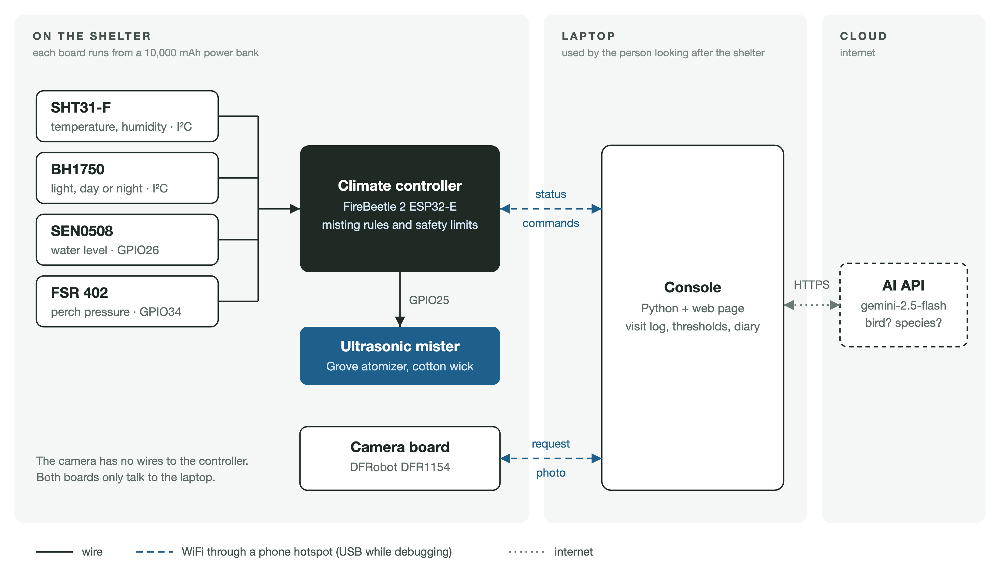

# Smart Misting Shelter for Superb Fairy-wrens

Source code for our COMP5047 Pervasive Computing project (University of Sydney, Semester 2 2026, Group 18).

The shelter is a small 3D-printed structure that gives urban birds shade and, on hot days, short bursts of mist. A pressure sensor under the perch notices when something lands, a camera takes a photo, and an AI vision model checks whether it is a bird and which species. The climate controller only mists when it is daytime, hot, not too humid and there is water in the tank. Every spray is time-limited.



## Folders

| Folder | What it contains |
|---|---|
| `climate/` | FireBeetle 2 ESP32-E firmware (PlatformIO). `src/shelter.cpp` is the final firmware. `include/ShelterLogic.h` has the perch detection and the mist time limits, and `test_host/` tests that logic on a laptop. The other files in `src/` are bring-up and hardware test programs. |
| `camera/` | DFRobot DFR1154 (ESP32-S3) camera firmware. `src/shelter_cam.cpp` sends a JPEG when the console asks for one. |
| `common/ShelterNet/` | WiFi code shared by both boards: Bluetooth WiFi setup, auto-discovery and firmware updates over WiFi. |
| `app/` | Laptop console (Python and a web page). It talks to both boards, calls the AI API and saves visits. |
| `tests/` | Python tests for the console and the hardware test page. |
| `tools/` | Scripts that build standalone console packages and draw the circuit diagram. |
| `docs/` | Circuit diagram and report figures. |
| `hardware_test.py` | Component test page, used with `climate/src/hardware_test.cpp`. |

## Wiring

| Part | Connection |
|---|---|
| SHT31-F (temperature, humidity) and BH1750 (light) | I²C: SDA to GPIO21, SCL to GPIO22, 3V3 and GND |
| SEN0508 water level sensor | OUT to GPIO26 (LOW when there is water) |
| FSR 402 under the perch | 3V3 to FSR to GPIO34, with 10 kΩ from GPIO34 to GND |
| Grove Water Atomization | SIG to GPIO25, VCC to the board's VCC pin, GND to GND |

The full diagram is in [`docs/circuit/shelter_schematic.png`](docs/circuit/shelter_schematic.png).

## Uploading the firmware

We used VS Code with PlatformIO. The ESP32 platform version is pinned in each `platformio.ini`.

```sh
pio run -d climate -e shelter -t upload
pio run -d camera -e shelter_cam -t upload
```

WiFi is set up from a phone with Espressif's "ESP BLE Provisioning" app. The PIN is defined in `common/ShelterNet/ShelterNet.h`; change it for your own build. After that, firmware can be updated over WiFi with the `shelter_ota` and `shelter_cam_ota` environments.

## Running the console

Python 3.8 or newer is enough. pyserial is already included in `app/vendor/`.

```sh
cp .env.example .env          # then add your API key
python3 app/shelter_console.py
python3 app/shelter_console.py --simulate   # try it without any hardware
```

The page opens in the browser and can be switched between Chinese and English with the button at the top right. The API key stays in `.env`, which is not part of this repository.

## Tests

```sh
c++ -std=c++17 -Iclimate/include climate/test_host/test_logic.cpp -o /tmp/test_logic && /tmp/test_logic
python3 -m unittest discover tests
```

## Safety

Every way the mister can turn on is time-limited. One spray stops after 30 s at most, total misting per hour is capped, and the mister stops within 20 ms if the tank runs dry. Only a separate safety task on the controller is allowed to switch the mister pin on.
